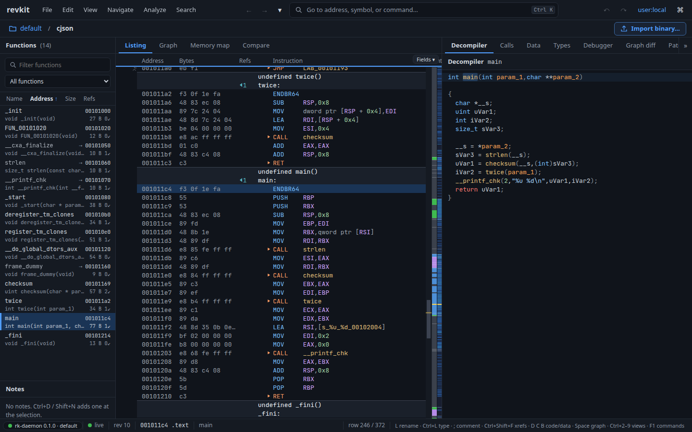

# revkit

A reverse-engineering workbench built around Ghidra's decompiler and SLEIGH
engine, compiled into a native C++ server.

One server, `rk-daemon`, loads ELF, PE, Mach-O and raw firmware images, analyzes
them, and serves the results to a web UI, a desktop app, Python and
TypeScript SDKs, an MCP server for AI agents, and command-line tools. People
and agents can work on the same project at once: every rename, type and
comment records who made it and why, and can be undone.



## Features

- **Decompiler**: Ghidra's decompiler, fed by revkit's own analysis. Measured
  against source code: see [decomp-quality.md](docs/decomp-quality.md).
- **Analysis**: function discovery, data and strings, switch tables,
  prototype inference, DWARF and PDB, C header import, auto-created structs,
  MSVC RTTI, Function ID, library prototypes.
- **Firmware**: raw images with processor and load-address detection, as well as
  every SLEIGH language Ghidra ships (189), Harvard and word-addressed MCUs.
- **Emulator and debugger**: a p-code emulator with rewind and Python hooks;
  live debugging over GDB remote (gdbserver, QEMU, OpenOCD, J-Link) with
  stack unwinding, watches and conditional breakpoints; firmware machines
  with interrupts and peripherals.
- **Comparing binaries**: program diff, function compare with markup
  porting, and BSim similarity search.
- **Collaboration**: accounts, roles, API tokens, TLS, live multi-user
  editing, and replication between servers.
- **Automation**: Python and TypeScript SDKs, an in-app Python console and
  scripts, an MCP server, and sandboxed WebAssembly plugins.
- **Ghidra interop**: bring a Ghidra project's work into revkit and send
  revkit's edits back.

## Quick start

revkit runs on Linux, x86-64 or aarch64 (including Linux VMs on Apple
Silicon Macs). It also runs in Docker. See [Slow Start: run with Docker](#docker)

**1. Install** (no root needed):

```sh
curl -fsSL https://raw.githubusercontent.com/meenmachine1/revkit/main/install.sh | sh
```

It downloads the latest release for your machine, checks it against the
release's checksums, and installs it into `~/.local`. Run it again, or
`revkit update`, to update. On a system older than the build (glibc below
2.34: Ubuntu 20.04, say) it runs the server in Docker instead, if Docker is
installed.

**2. Run it:**

```sh
revkit /bin/ls
```

This starts the server, imports `/bin/ls` and opens
<http://revkit.localhost:50052> in your browser. `revkit` on its own opens
it again; `revkit stop`, `revkit status` and `revkit logs` do what they
say. Your work is kept in `~/.local/share/revkit/projects`. Import more
binaries with **Import binary…** or by dropping a file on the page.

Rather do it by hand, or not pipe a script into `sh`? See the
[slow start](#slow-start).

**3. Script it** (optional). The Python SDK ships in the bundle:

```sh
python3 -m venv ~/rk-venv
~/rk-venv/bin/pip install "$(ls ~/.local/share/revkit/current/share/revkit/sdk/revkit-*.whl)[mcp]"
```

```python
from revkit import Client

with Client("127.0.0.1:50051", actor="user:me") as rk:
    prog = rk.program("default/ls")
    biggest = max(prog.functions(), key=lambda f: f.instruction_count)
    print(prog.decompile(biggest.entry.offset).text)
    prog.rename(biggest.entry.offset, "biggest_function", reason="most instructions")
```

**4. Connect an AI agent** (optional). With the `[mcp]` extra installed,
register revkit's MCP server with the coding agents on your computer
(Claude Code, Codex, Cursor, Gemini CLI); it shows each change and asks
first:

```sh
revkit mcp setup            # or: ~/rk-venv/bin/revkit-mcp setup  (--dry-run to look first)
```

By hand, for Claude Code: `claude mcp add revkit -- ~/rk-venv/bin/revkit-mcp
--daemon 127.0.0.1:50051 --agent claude`; any MCP client works the same
way. The server ships a workflow guide for the agent (the `investigate`
prompt). The agent's edits show up live in the UI, marked `agent:claude`,
and can be reviewed or undone.

## Slow start

The same thing by hand.

**1. Check your system.** revkit's builds are for Linux on x86-64 or
aarch64 with glibc 2.34 or newer and GCC 12's C++ runtime: Ubuntu 22.04,
Debian 12, Fedora 36 and later.

```sh
uname -m          # x86_64 or aarch64
ldd --version     # the first line ends in the glibc version: 2.34 or more
```

On an older system (Ubuntu 20.04, say), use Docker (step 6) or
[build from source](#building-from-source).

**2. Download** the bundle for your machine and the checksums from the
[releases page](https://github.com/meenmachine1/revkit/releases), and check
them:

```sh
arch=$(uname -m)
base=https://github.com/meenmachine1/revkit/releases/download/v0.1.3
curl -fLO $base/revkit-0.1.3-linux-$arch.tar.gz
curl -fLO $base/SHA256SUMS
sha256sum --check --ignore-missing SHA256SUMS     # must say OK
```

**3. Unpack** it anywhere, no root needed, and put its `bin` on your PATH:

```sh
mkdir -p ~/opt
tar -xzf revkit-0.1.3-linux-$arch.tar.gz -C ~/opt
export PATH=~/opt/revkit-0.1.3-linux-$arch/bin:$PATH
rk-daemon --version
# to keep it on your PATH in new shells:
echo "export PATH=\"$HOME/opt/revkit-0.1.3-linux-$arch/bin:\$PATH\"" >> ~/.profile
```

Or install the `.deb` instead (`revkit_0.1.3_amd64.deb` or
`revkit_0.1.3_arm64.deb`): `sudo apt install ./revkit_0.1.3_amd64.deb`
puts everything under `/usr`. On x86-64 there is also the desktop app,
`revkit-desktop_0.1.3_amd64.AppImage`: make it executable and run it; it
starts its own server, so you can stop here.

**4. Start the server:**

```sh
rk-daemon --no-auth --project-dir ~/revkit-projects --browse-root ~ --open /bin/ls
```

- `--no-auth`: no accounts. Only this computer can connect, and anyone on
  it is an admin. Leave it out to sign in with accounts; the first run then
  asks you to make one ([security.md](docs/security.md)).
- `--project-dir`: where your work is kept between runs. Without it,
  projects live in memory and are gone when the server stops.
- `--browse-root`: what the Open dialog may browse on this machine.
- `--open`: a binary to import as it starts (optional).
- `--http 127.0.0.1:8080` moves the web UI from port 50052, and `--grpc`
  moves the port the SDKs, MCP and tools use from 50051.

**5. Open** <http://revkit.localhost:50052>. Stop the server with Ctrl+C;
your projects stay in `~/revkit-projects`. For <http://revkit.localhost>
without the port, see
[getting-started.md](docs/getting-started.md#a-port-free-name-httprevkitlocalhost).

<a id="docker"></a>
**6. With Docker:** run the same bundle in a Debian 12
container, as you, with your home read-only and the projects writable:

```sh
mkdir -p ~/revkit-projects
docker run -d --name revkit --network host -u "$(id -u):$(id -g)" -e HOME="$HOME" \
  -v ~/opt/revkit-0.1.2-linux-$arch:/opt/revkit:ro -v ~/revkit-projects:$HOME/revkit-projects \
  -v "$HOME:$HOME:ro" debian:12 \
  /opt/revkit/bin/rk-daemon --no-auth --project-dir "$HOME/revkit-projects" --browse-root "$HOME"
```

Stop it with `docker rm -f revkit`.

## Documentation

| | |
| --- | --- |
| [Getting started](docs/getting-started.md) | Installing, a shared server with accounts and TLS, the views, the SDK, MCP, plugins |
| [UI](docs/ui.md) | Every view, command and key binding |
| [API](docs/api.md) | The gRPC/Connect API, the SDKs and the MCP tools |
| [Firmware](docs/firmware.md) | Raw images, detection, firmware emulation |
| [Debugger](docs/debugger.md) and [emulator](docs/emulator.md) | Targets, timelines, hooks |
| [Collaboration](docs/collab.md) and [security](docs/security.md) | Multi-user, replication, accounts, TLS |
| [Status](docs/status.md) | What's built, with measurements |
| [Development](docs/development.md) | Building, the layout, command-line recipes |

## Building from source

You need CMake 3.20+, Ninja, a C++20 compiler, gRPC and protobuf, OpenSSL,
zlib, liblzma, libzstd, libbz2, GNU patch, Node.js 22 or newer (for the
UI), and a Ghidra 12.x install for its processor specs. On Ubuntu:

```sh
sudo apt install cmake ninja-build g++ libgrpc++-dev libprotobuf-dev protobuf-compiler-grpc \
    libssl-dev zlib1g-dev liblzma-dev libzstd-dev libbz2-dev patch
```

```sh
cmake --preset default && cmake --build --preset default
(cd sdk/ts && npm ci) && (cd ui && npm ci && npm run build)
build/tools/rk-daemon/rk-daemon --no-auth --open /bin/ls
```

The presets look for Ghidra in `~/ghidra/ghidra_12.1.4_PUBLIC`; see
[getting-started.md](docs/getting-started.md#ghidra-processor-specs) for
other locations. Tests, packaging and the repository layout are in
[development.md](docs/development.md).

## License

revkit is licensed under the GNU Affero General Public License, version 3 or
later ([LICENSE](LICENSE)). If you run a modified revkit as a service for
others, the AGPL asks you to offer them its source.

revkit includes third-party code under its own licenses, notably Ghidra's
decompiler and SLEIGH engine (Apache-2.0); see
[THIRD_PARTY_NOTICES.md](THIRD_PARTY_NOTICES.md).
